# Gaji A–Z: panduan untuk pemilik dan HR

Panduan ini mengikut satu klinik baharu melalui dua bulan gaji pertamanya: dari log masuk pertama pemilik hingga Borang EA. Setiap gambar ialah skrin sebenar dari laman staging Kuwick, diambil pada 3 November 2026 semasa langkah-langkah di bawah dibuat.

Klinik ini ialah demo: **Klinik Panduan Sdn Bhd** di Bandar Baru Bangi, Selangor. No. KWSP, PERKESO dan LHDN syarikat adalah rekaan. Tiga orangnya juga rekaan: **Dr Amin Contoh** (doktor, gaji bulanan), **Siti Contoh** (jururawat, gaji bulanan, mula bekerja pertengahan Oktober) dan **Dr Lim Contoh** (lokum luar yang dibayar ikut sesi).

Setiap langkah ada satu gambar, apa yang perlu dibuat, dan **Semak:** apa yang perlu dilihat sebelum teruskan. Nama butang ditulis seperti di skrin (Bahasa Inggeris). Langkah bertanda ⚠ ada masalah semasa ujian; semuanya disenaraikan di bawah "Masalah yang ditemui" di hujung panduan.

Kandungan:

- A. Log masuk pertama dan wizard Set up payroll (8 langkah)
- B. Menambah tiga orang
- C. Syif dan roster untuk sebulan
- D. Kehadiran: clock-in QR dari telefon, datang lewat, pembetulan, lebih masa
- E. Cuti: cuti tahunan dan cuti tanpa gaji
- F. Tuntutan: perbatuan dan resit
- G. Gaji: Oktober, kemudian November, slip gaji, bayaran, caruman berkanun
- H. Akhir tahun: Borang EA
- Masalah yang ditemui

## A. Log masuk pertama dan wizard Set up payroll

### A1. Log masuk

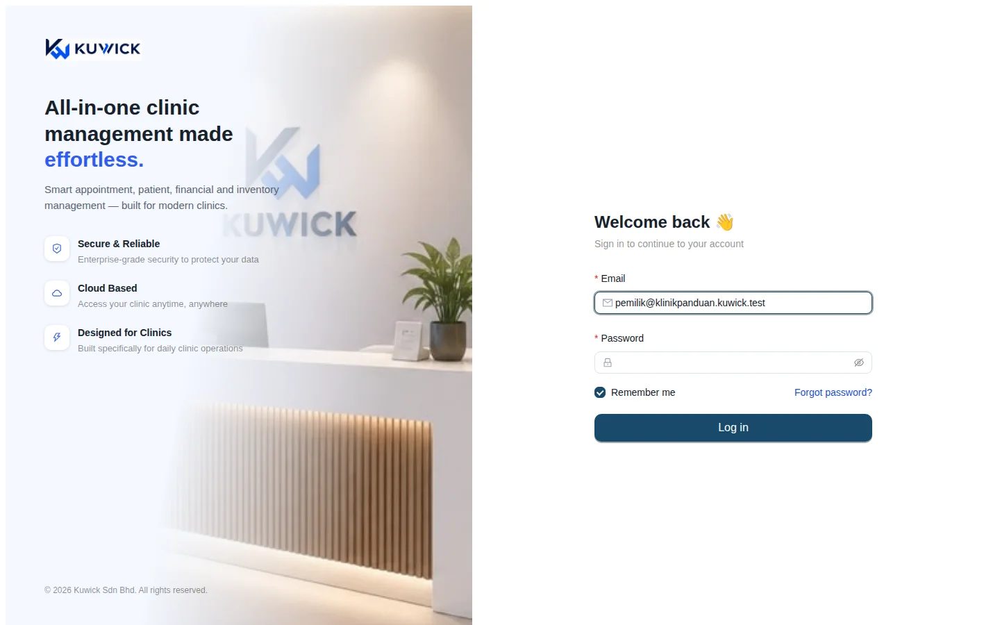

Buka Kuwick dan log masuk dengan e-mel dan kata laluan pemilik yang diberi oleh wakil Kuwick anda.

**Semak:** anda sampai di laman utama Kuwick dengan nama klinik anda di kanan atas.

### A2. HR dibuka pada "Set up payroll"

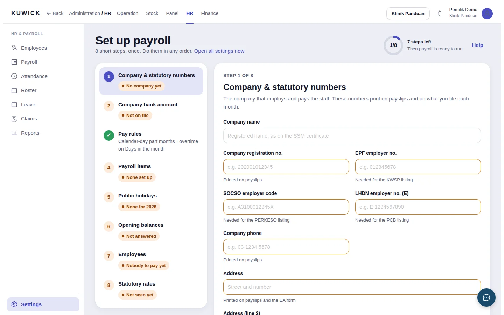

Tekan **HR**. Klinik baharu dibuka pada **Set up payroll**: lapan langkah ringkas, ikut apa-apa susunan. Bulatan di atas mengira langkah yang tinggal.

**Semak:** setiap langkah di kiri ada nota oren sehingga ia siap.

### A3. Langkah 1: syarikat dan nombor berkanun

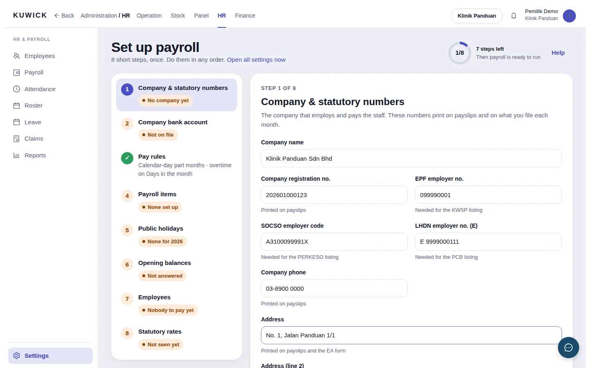

Taip nama syarikat seperti dalam sijil SSM, no. pendaftaran, dan no. majikan KWSP, PERKESO dan LHDN (E). Tambah telefon, alamat (poskod mengisi bandar dan negeri), pegawai yang menandatangani Borang EA, dan kelas HRD Corp anda. Tekan **Save & next**.

**Semak:** semua ini dicetak pada setiap slip gaji dan Borang EA, jadi semak setiap digit dengan surat dari KWSP, PERKESO dan LHDN.

### A4. Langkah 2: akaun bank syarikat

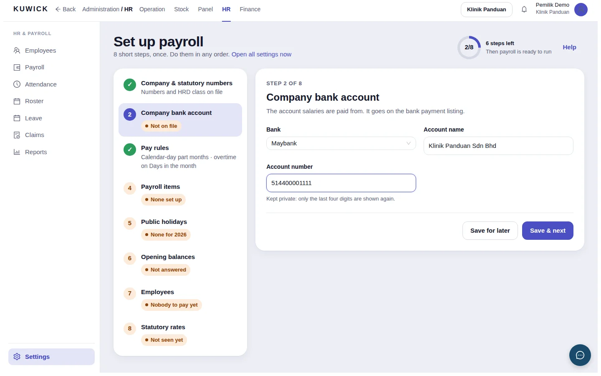

Pilih bank yang membayar gaji dan taip no. akaun.

**Semak:** no. akaun sama dengan penyata bank.

### A5. Langkah 3: peraturan gaji

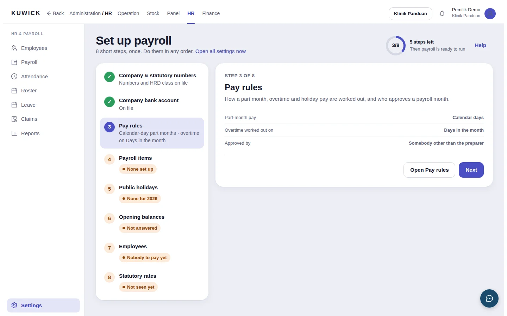

Ini menunjukkan cara bulan tidak penuh, lebih masa dan kelulusan dikira. Nilai asal sesuai untuk kebanyakan klinik; **Open Pay rules** untuk mengubahnya.

**Semak:** "Approved by" ialah siapa yang boleh meluluskan sebulan gaji. ⚠ Lihat masalah 4.

### A6. Langkah 4: item gaji

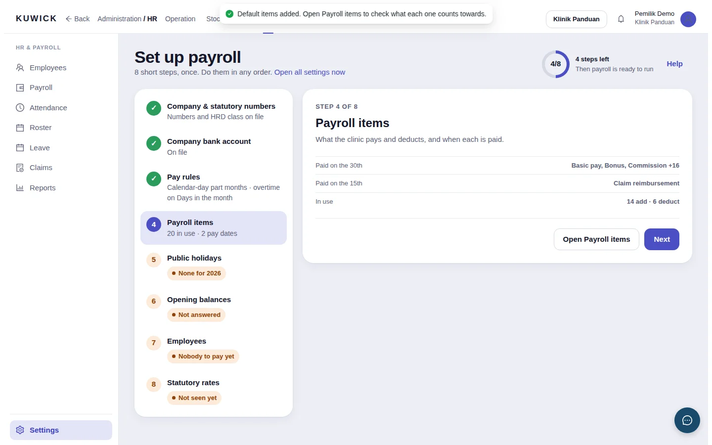

Tekan **Add default items**: gaji pokok, lebih masa, tuntutan, cuti tanpa gaji dan elaun serta potongan biasa, dengan tarikh setiap satu dibayar.

**Semak:** langkah ini menunjukkan bilangan item yang digunakan dan tarikh bayaran (di sini 30hb untuk gaji, 15hb untuk tuntutan).

### A7. Langkah 5: cuti umum

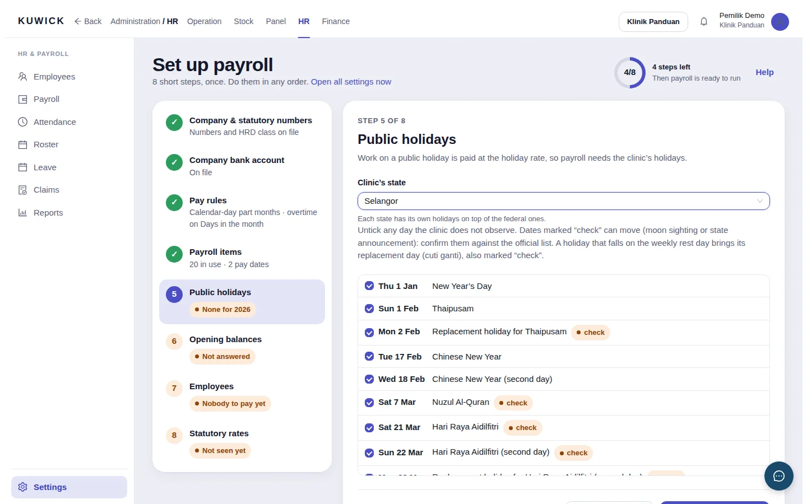

Pilih negeri klinik. Kuwick menyenaraikan cuti persekutuan dan negeri untuk tahun ini; nyahtanda hari yang klinik tidak bercuti, kemudian tekan **Add … holidays**.

**Semak:** tarikh bertanda "check" (anak bulan, cuti ganti) dengan senarai rasmi.

### A8. Langkah 6: baki pembukaan

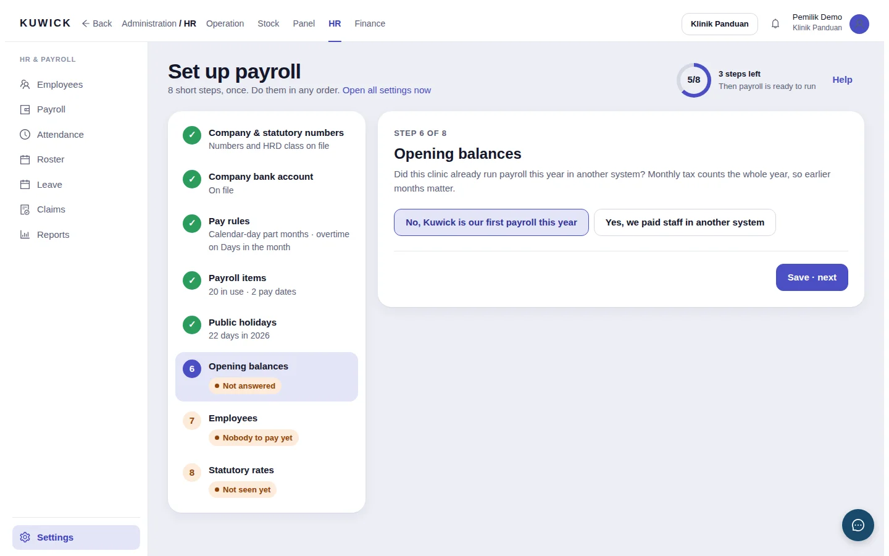

Jika Kuwick ialah sistem gaji pertama anda tahun ini, tekan **No**. Jika anda sudah membayar gaji tahun ini dalam sistem lain, tekan **Yes** dan masukkan jumlah setiap orang supaya PCB dikira dengan betul.

**Semak:** klinik yang bertukar sistem di pertengahan tahun mesti jawab Yes, atau PCB akan terlalu rendah.

### A9. Langkah 7: pekerja

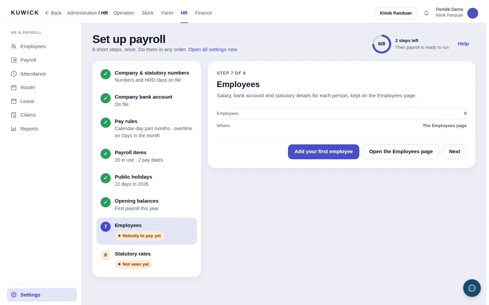

Langkah ini siap apabila ada orang untuk dibayar. **Add your first employee** membuka borang di bahagian B.

**Semak:** kiraan naik apabila anda menambah orang.

### A10. Langkah 8: kadar berkanun

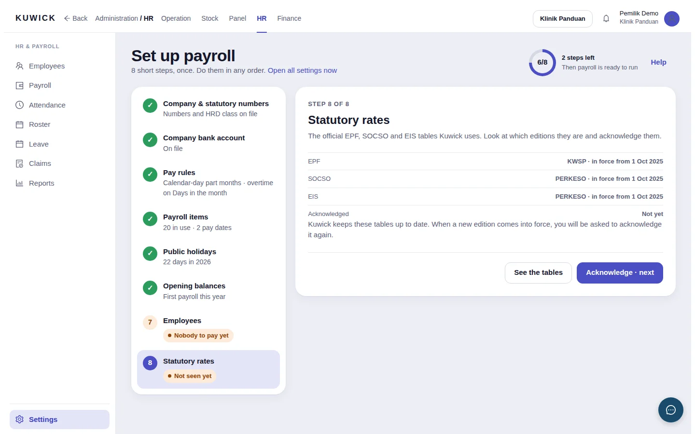

Ini jadual rasmi KWSP, PERKESO dan SIP yang digunakan Kuwick, dengan tarikh setiap satu berkuat kuasa. Tekan **Acknowledge · next**.

**Semak:** apabila jadual baharu berkuat kuasa, Kuwick meminta anda mengakuinya semula.

## B. Menambah tiga orang

### B1. Senarai pekerja, sebelum sesiapa ditambah

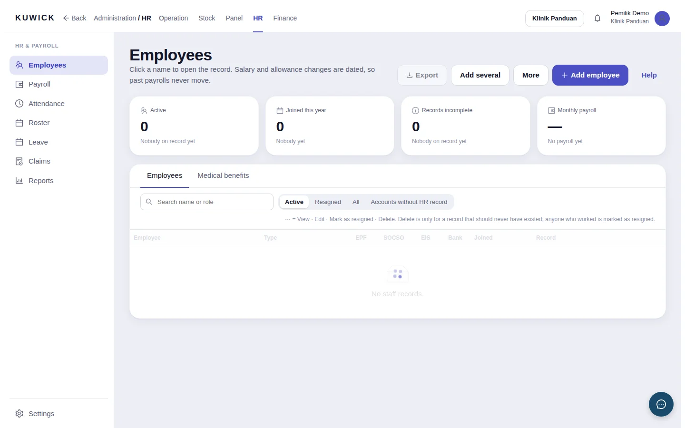

HR → **Employees** → **Add employee**. Borang ini ada empat langkah ringkas; hanya nama yang wajib untuk menyimpan.

**Semak:** senarai kosong untuk klinik baharu.

### B2. Doktor: siapa dia

Taip nama penuh, pilih **Doctor (resident)** sebagai peranan akaun dan taip no. IC. Kuwick membaca tarikh lahir dari IC.

**Semak:** tarikh lahir dan jantina betul; PERKESO dan SIP bergantung pada umur.

### B3. Doktor: pekerjaan

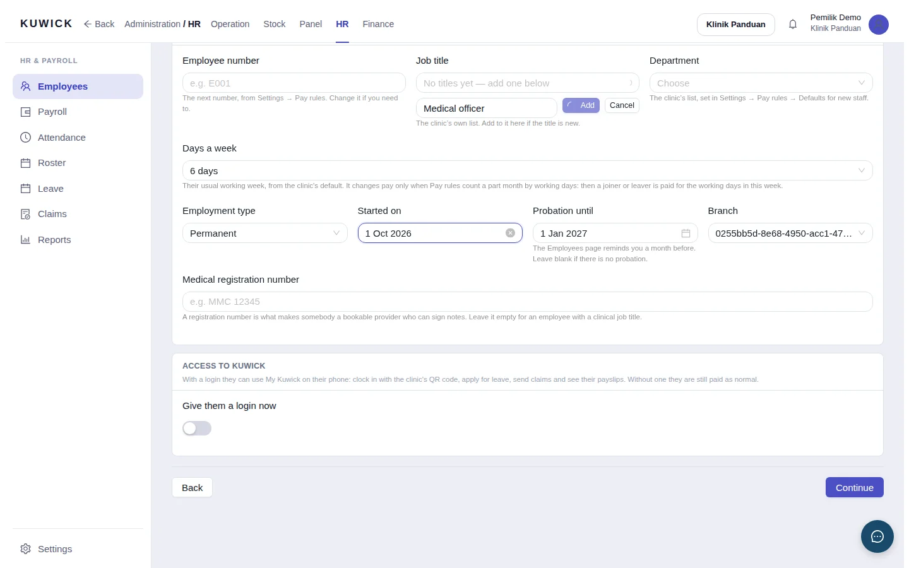

Pilih jawatan, tarikh mula dan cawangan. No. pekerja (E001) diisi untuk anda.

**Semak:** tarikh mula. Orang yang mula di pertengahan bulan dibayar dari hari itu sahaja.

### B4. Doktor: gaji dan berkanun

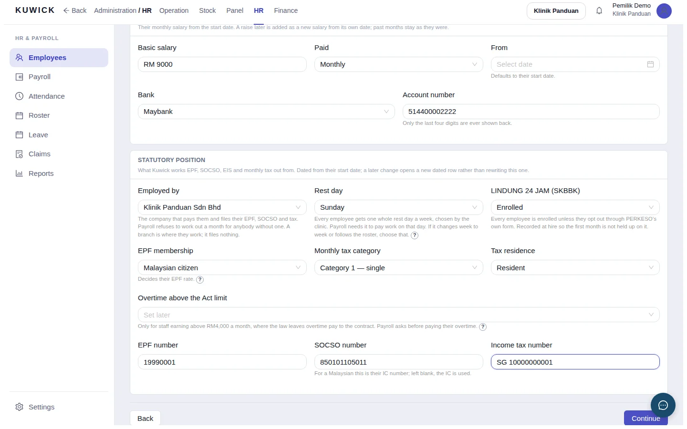

Taip gaji bulanan (RM 9,000), bank dan no. akaun, hari rehat, keahlian KWSP, kategori dan taraf cukai, serta no. KWSP, PERKESO dan cukai pendapatan.

**Semak:** no. KWSP atau cukai yang tiada tidak menghalang gaji, tetapi Kuwick memberi amaran sebelum kelulusan.

### B5. Doktor: semakan

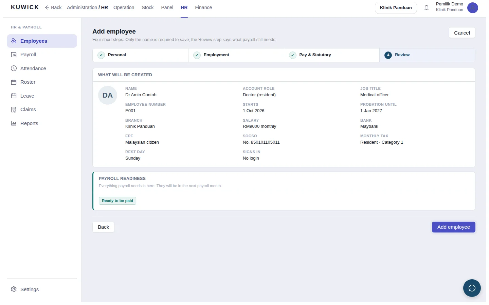

Langkah akhir menunjukkan semua yang akan disimpan dan sama ada gaji sudah lengkap.

**Semak:** "Ready to be paid". Tekan **Add employee**.

### B6. Rekod doktor

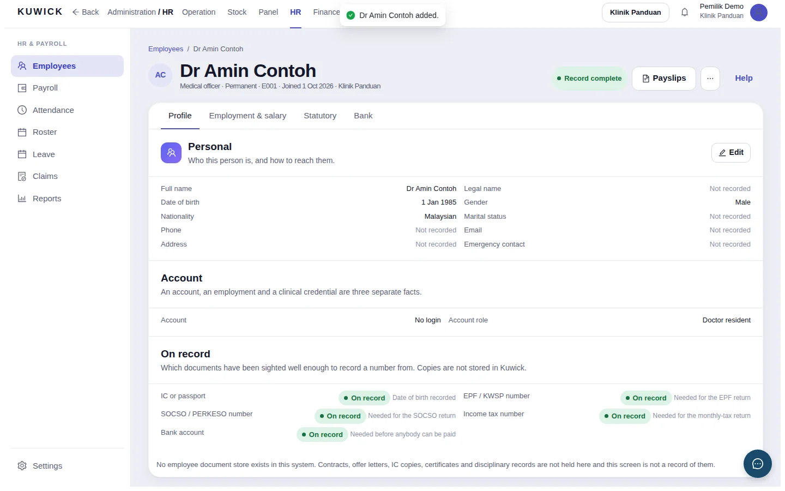

Rekod dibuka pada **Profile**, dengan tab untuk pekerjaan dan gaji, berkanun dan bank.

**Semak:** "Record complete", dan no. pekerja (E001) diberi secara automatik. "On record" di sebelah no. IC, KWSP, PERKESO dan cukai.

### B7. Jururawat: siapa dia

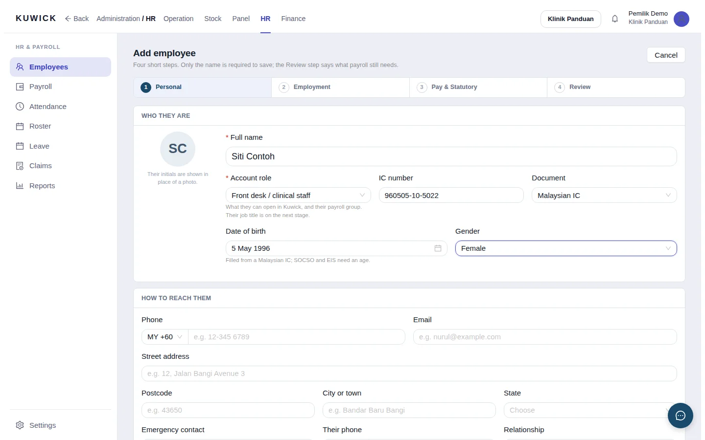

Siti Contoh, **Front desk / clinical staff**, dengan no. IC.

**Semak:** jantina ditetapkan (ia menentukan cuti bersalin atau cuti paterniti).

### B8. Jururawat: pekerjaan, dan log masuk My Kuwick

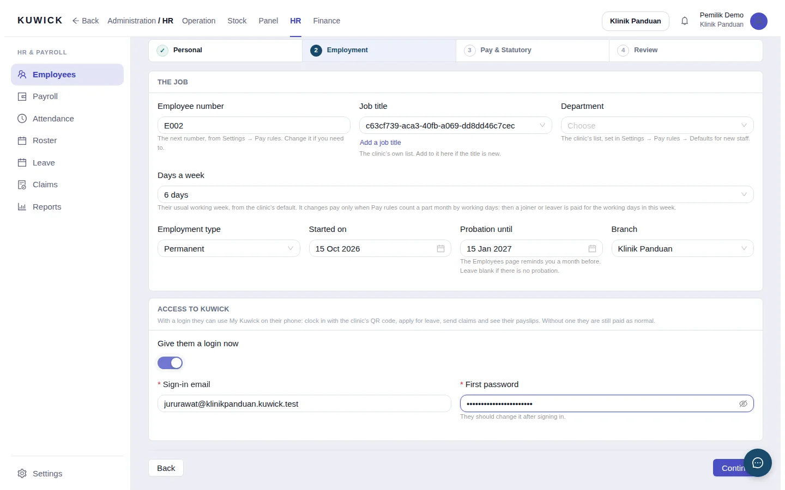

Dia mula pada **15 Oktober 2026**. Hidupkan **Give them a login now** dan taip e-mel serta kata laluan pertamanya: dia guna **My Kuwick** di telefon untuk clock-in, memohon cuti, menghantar tuntutan dan melihat slip gaji.

**Semak:** berikan e-mel dan kata laluan itu sendiri; Kuwick tidak menghantarnya.

### B9. Jururawat: gaji dan berkanun

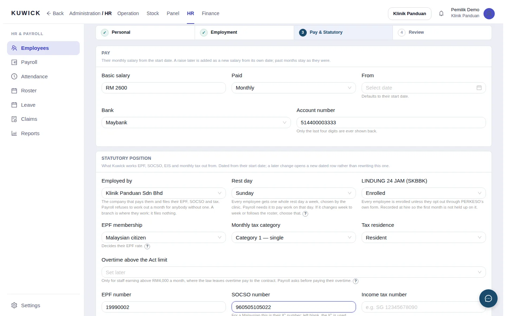

Gaji bulanan RM 2,600. No. cukai pendapatannya sengaja dibiarkan kosong, untuk menunjukkan amaran yang muncul kemudian.

**Semak:** hari rehat; ia menentukan hari mana dikira untuk lebih masa dan bayaran hari rehat.

### B10. Jururawat: semakan

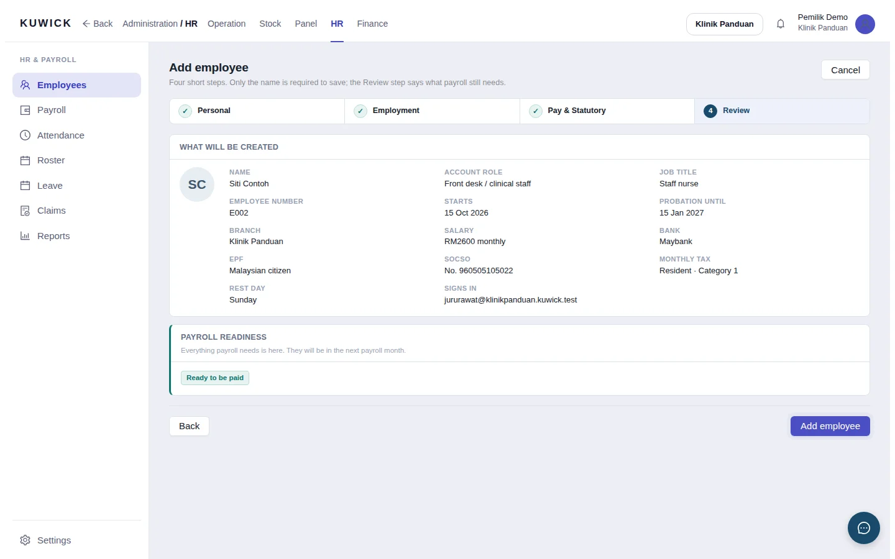

Semakan menyenaraikan apa yang gaji masih perlukan.

**Semak:** no. cukai yang tiada disebut di sini.

### B11. Rekod jururawat

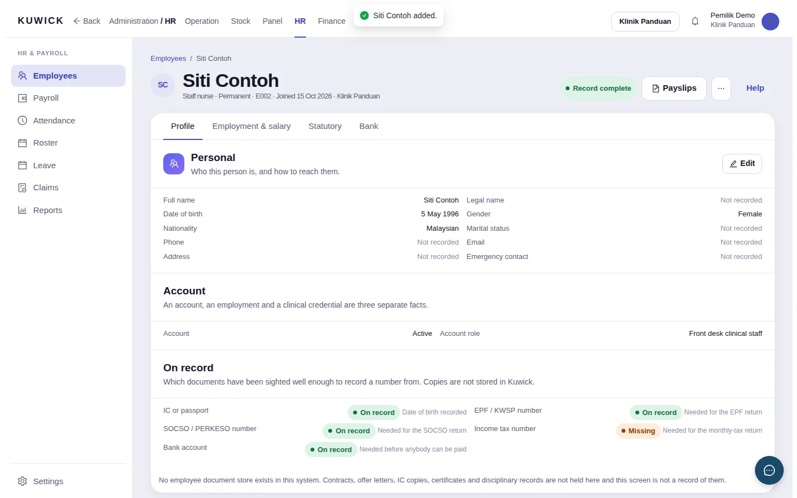

**Semak:** Account "Active" (dia ada log masuk), dan "Income tax number: Missing".

### B12. ⚠ Lokum yang dibayar ikut jam

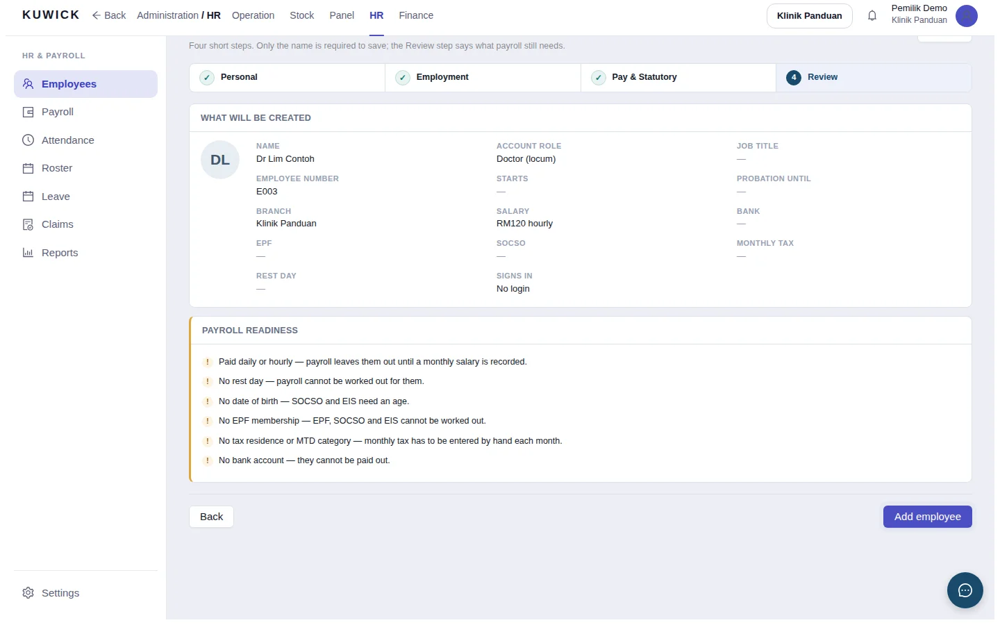

Dr Lim Contoh ialah lokum luar yang dibayar RM 120 sejam. Jika anda pilih **Hourly**, semakan berkata "Paid daily or hourly — payroll leaves them out". Gaji Kuwick hanya membayar gaji bulanan.

**Semak:** jangan simpan lokum luar sebagai pekerja. Letakkan mereka dalam roster ikut nama (langkah C7) dan bayar dengan baucar bayaran melalui Finance. Lihat masalah 3.

### B13. Senarai pekerja, dengan dua staf

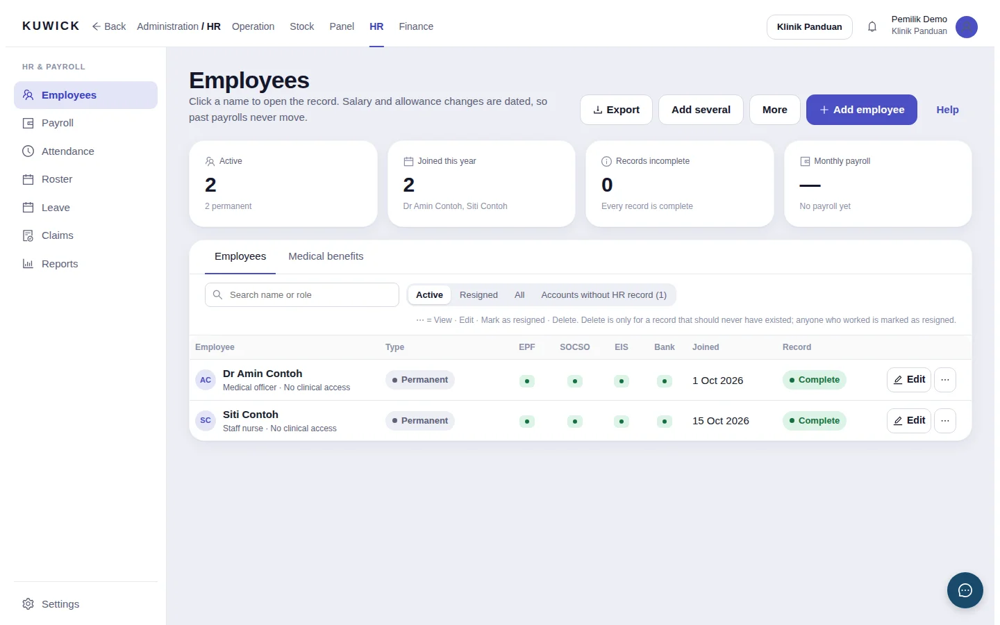

**Semak:** kedua-duanya menunjukkan no. pekerja, cawangan dan tarikh mula.

## C. Syif dan roster untuk sebulan

### C1. Syif staf

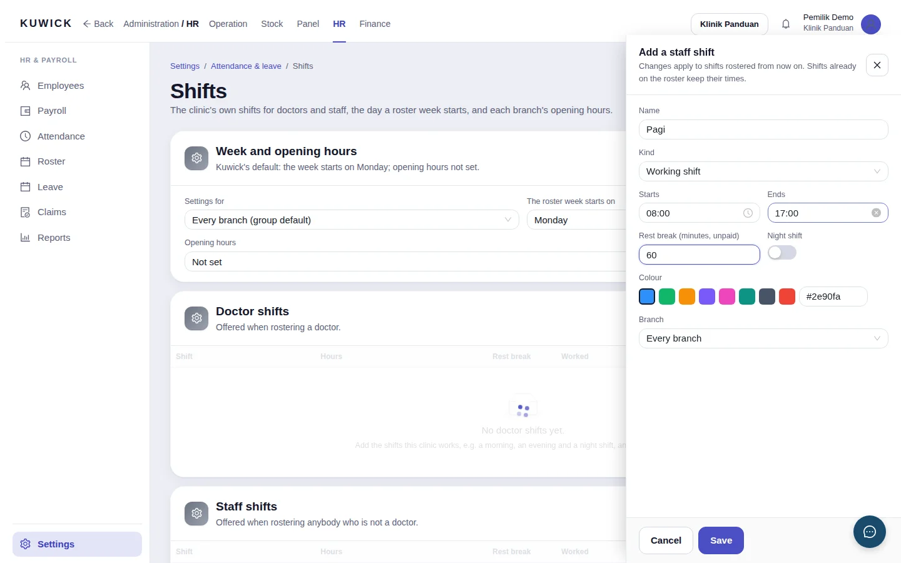

HR → **Settings** → **Shifts** → **Add shift** di bawah Staff shifts. "Pagi", 08:00 hingga 17:00, rehat 60 minit. Tekan **Save**.

**Semak:** minit rehat; ia ditolak dari jam bekerja.

### C2. Syif doktor

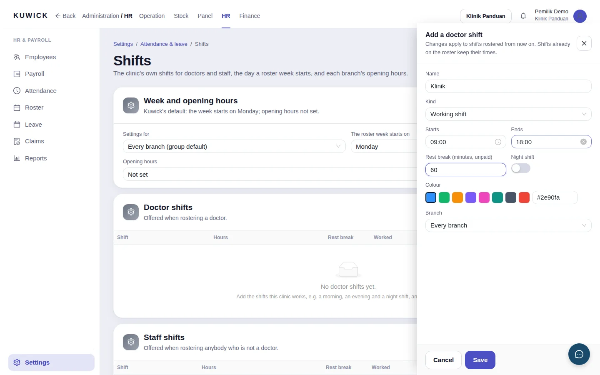

Di bawah Doctor shifts: "Klinik", 09:00 hingga 18:00.

**Semak:** doktor dan staf ada senarai berasingan, jadi setiap roster hanya menawarkan syifnya sendiri.

### C3. Kedua-dua syif

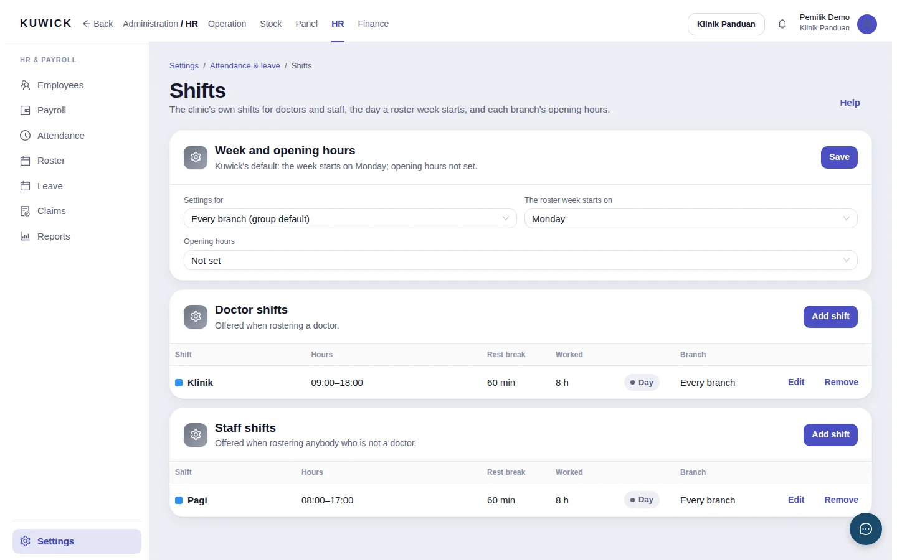

**Semak:** kedua-dua syif tersenarai, setiap satu dengan warnanya.

### C4. Pilih hari dalam roster

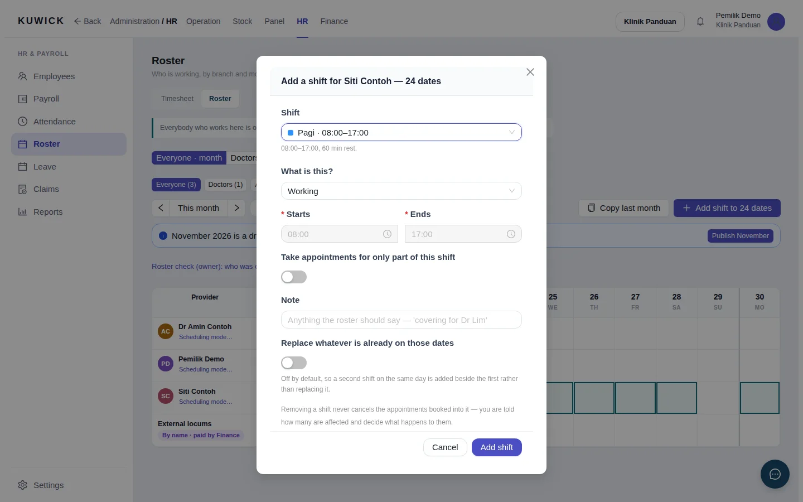

HR → **Roster** → **Everyone · month**. Klik setiap hari dalam baris Siti (Isnin hingga Sabtu), kemudian tekan **Add shift to … dates** dan pilih "Pagi".

**Semak:** butang mengira hari yang anda pilih.

### C5. Syif dengan masa sendiri

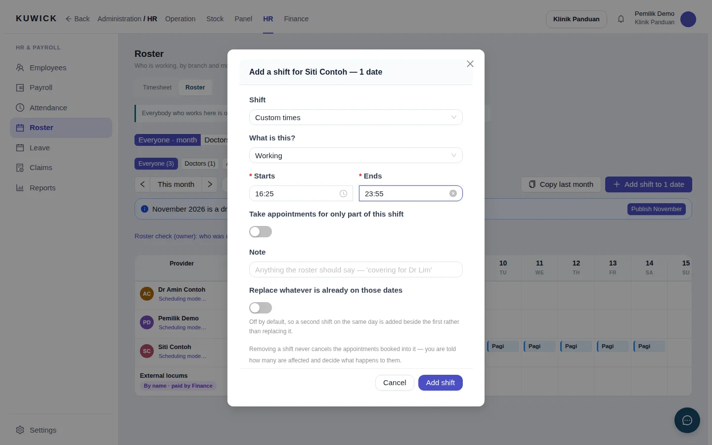

Untuk satu hari, pilih **Custom times** dan bukan syif. (Dalam ujian ini, syif jururawat hari ini bermula beberapa minit sebelum dia sampai, untuk menunjukkan datang lewat di bahagian D.)

**Semak:** syif yang melepasi tengah malam ditanda "next day".

### C6. Syif doktor

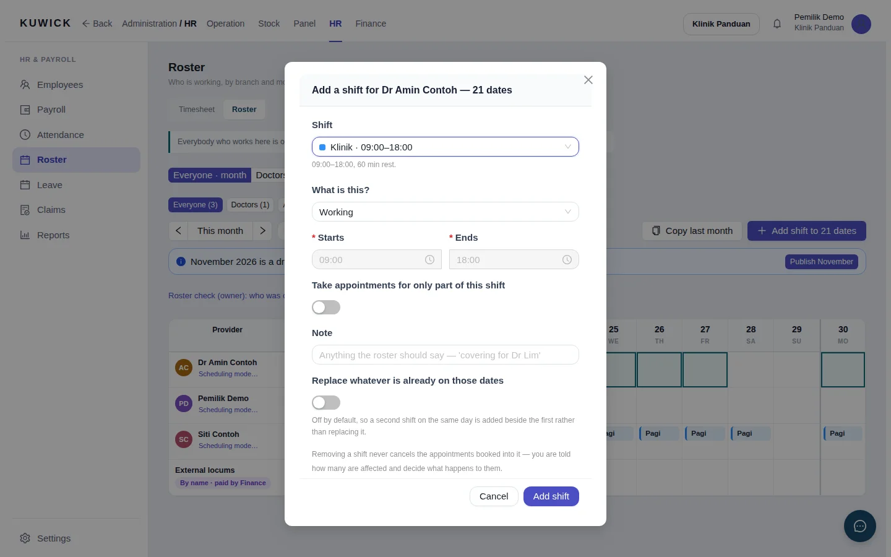

Sama untuk Dr Amin, Isnin hingga Jumaat, dengan syif "Klinik".

**Semak:** tajuk tetingkap menyebut nama orang itu dan bilangan tarikh.

### C7. Lokum luar pada hari Sabtu

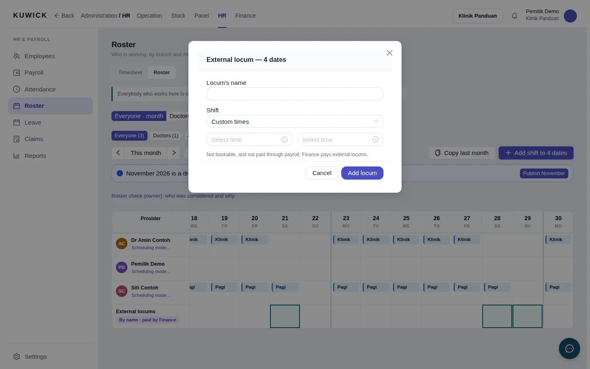

Baris **External locums** ialah untuk lokum yang bukan staf. Klik hari Sabtu, kemudian **Add shift to … dates**.

**Semak:** baris itu berkata "paid by Finance": syif ini tidak masuk gaji.

### C8. Nama dan masa lokum

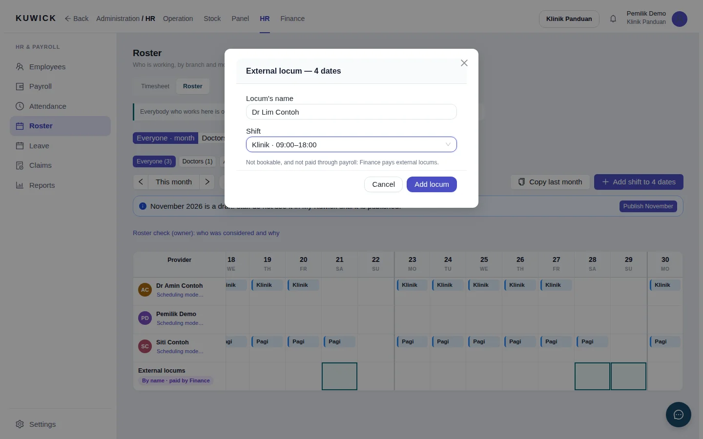

Taip nama lokum dan pilih syif. Tekan **Add locum**.

**Semak:** nota "Not bookable, and not paid through payroll".

### C9. Bulan itu, sebelum diterbitkan

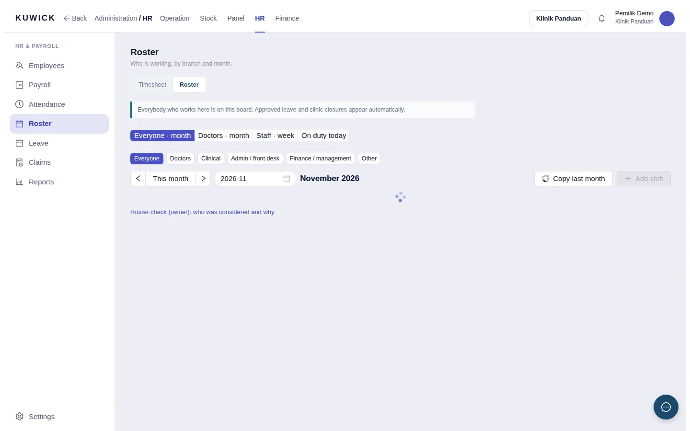

Bulan baharu ialah **draf**: staf belum nampak.

**Semak:** nota biru "… is a draft".

### C10. Terbitkan

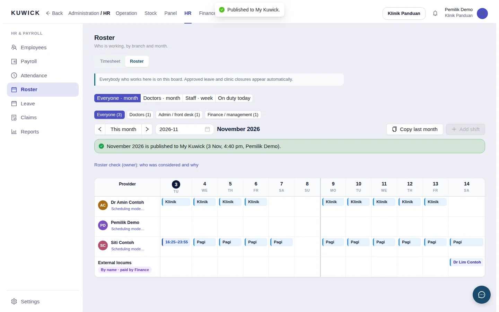

Tekan **Publish November**. Staf kini nampak syif mereka di My Kuwick.

**Semak:** nota hijau dengan tarikh dan siapa yang menerbitkan. Perubahan selepas itu ditunjuk sebagai "… changed since".

## D. Kehadiran

### D1. Skrin klinik (kiosk)

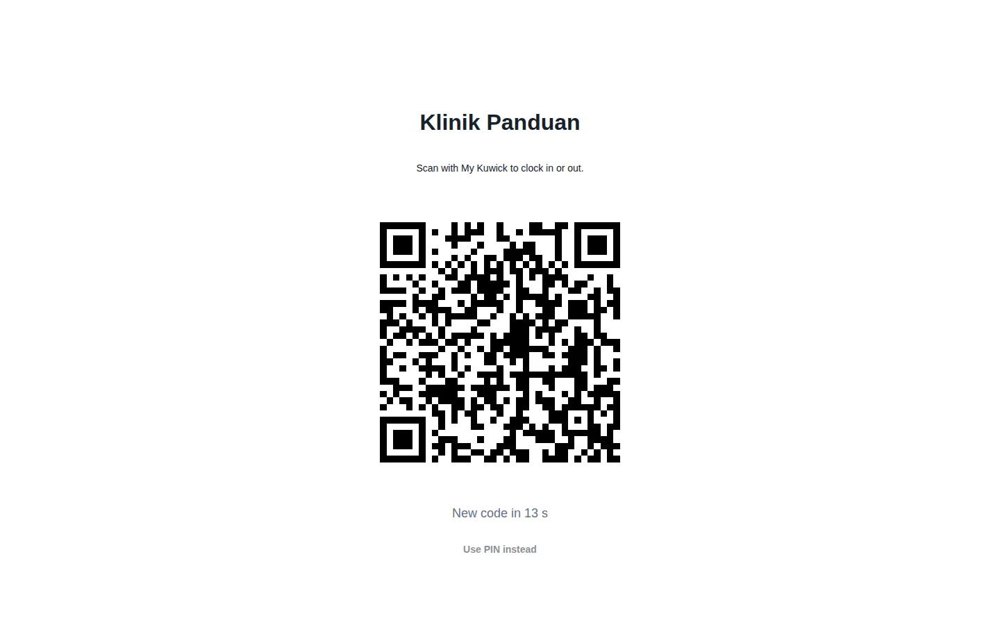

HR → **Attendance** → **Open kiosk screen**, pada tablet di kaunter. Ia menunjukkan kod QR yang bertukar setiap 30 saat.

**Semak:** biarkan skrin ini terbuka sepanjang hari. Staf tanpa telefon boleh guna PIN di sini.

### D2. My Kuwick di telefon jururawat

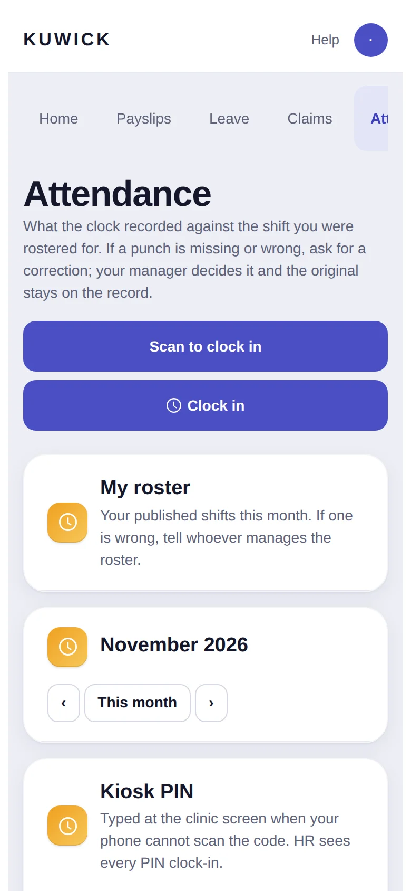

Siti membuka **My Kuwick** → **Attendance** di telefonnya. Syif yang diterbitkan tersenarai di bawah **My roster**.

**Semak:** dia nampak **Scan to clock in**.

### D3. Imbas kod

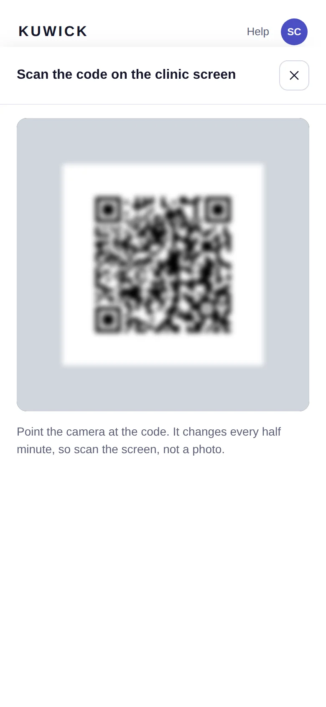

Dia tekan **Scan to clock in** dan halakan kamera ke skrin klinik.

**Semak:** telefon meminta izin kamera sekali; dia mesti benarkan.

### D4. Clock-in, lewat

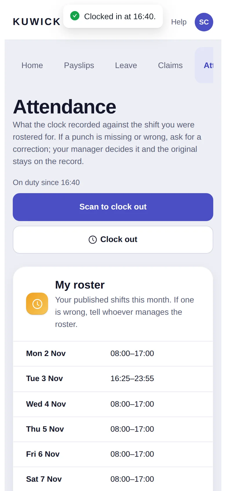

Telefon berkata **Clocked in at …** dan butang bertukar menjadi **Scan to clock out**.

**Semak:** masa di telefon ialah masa klinik.

### D5. HR nampak dia lewat

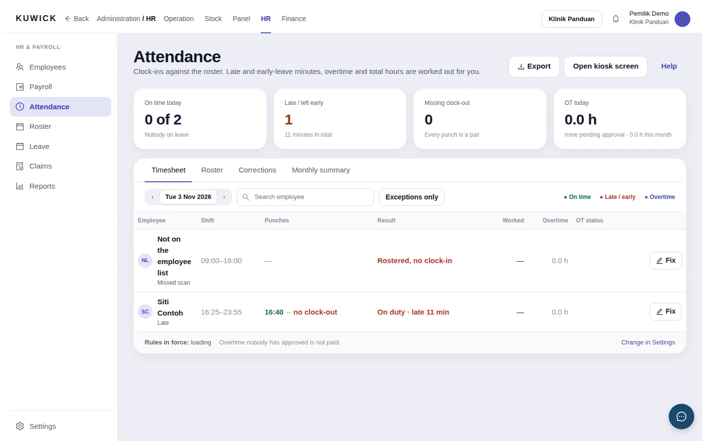

HR → **Attendance** menunjukkan setiap orang berbanding syifnya. Siti tertulis **On duty · late … min**.

**Semak:** kad "Late / left early" di atas, dan minit tenggang dalam "Rules in force".

### D6. ⚠ HR merekod clock-in yang tertinggal

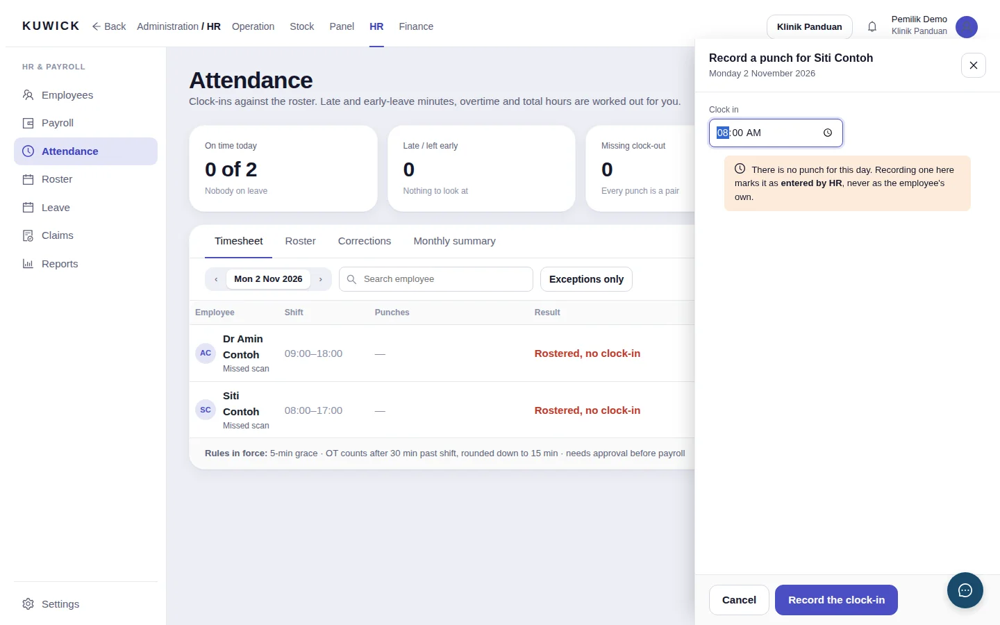

Pada Isnin 2 November Siti terlupa telefonnya. Pergi ke hari itu (‹), tekan **Fix** pada barisnya, taip masa clock-in (08:00) dan tekan **Record the clock-in**.

**Semak:** rekod itu ditanda "Entered by HR". Langkah ini gagal semasa ujian dan sudah dibaiki; lihat masalah 1.

### D7. Dia memohon pembetulan

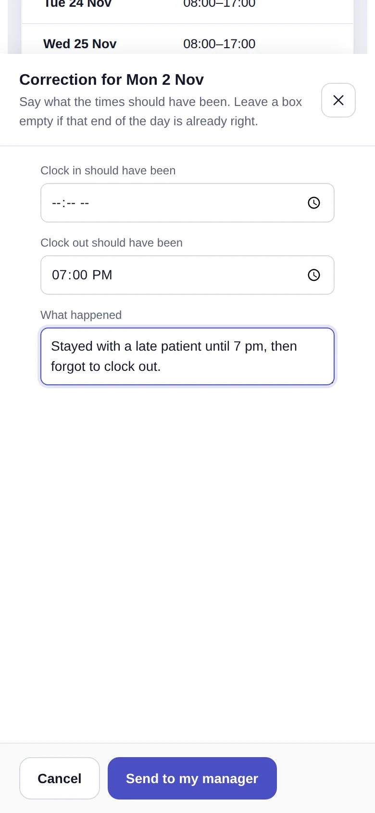

Di My Kuwick, pada Mon 2 Nov, dia tekan **Ask for a fix**: clock-out sepatutnya 19:00, dengan sebabnya. **Send to my manager**.

**Semak:** rekod asal kekal; pembetulan ditunjuk di sebelahnya.

### D8. Pengurus meluluskan pembetulan

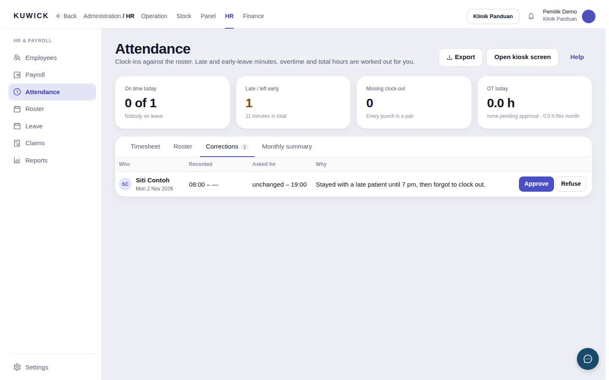

HR → **Attendance** → **Corrections** menyenaraikan permohonan staf. Tekan **Approve**.

**Semak:** masa yang diminta dan sebabnya sebelum meluluskan.

### D9. Lebih masa menunggu kelulusan

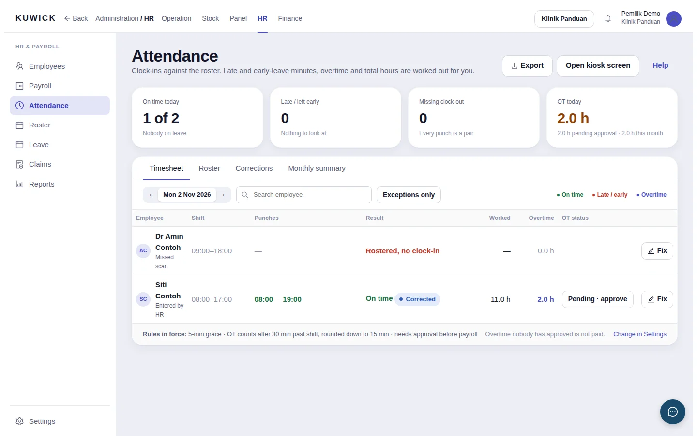

2 November kini 08:00 hingga 19:00: dua jam melepasi syif. Lebih masa tidak dibayar sehingga pengurus meluluskannya. Tekan **Pending · approve**.

**Semak:** jam lebih masa, dan "Rules in force" (minit minimum dan pembundaran). ⚠ Lihat masalah 6.

### D10. Lebih masa diluluskan

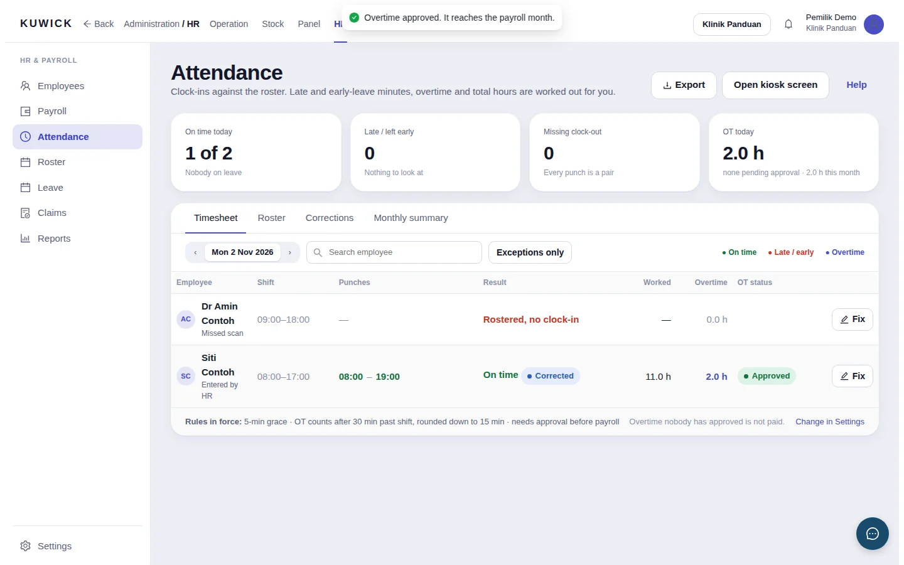

**Semak:** "Approved". Ia dibayar dalam gaji November.

## E. Cuti

### E1. Cuti tahunan dari My Kuwick

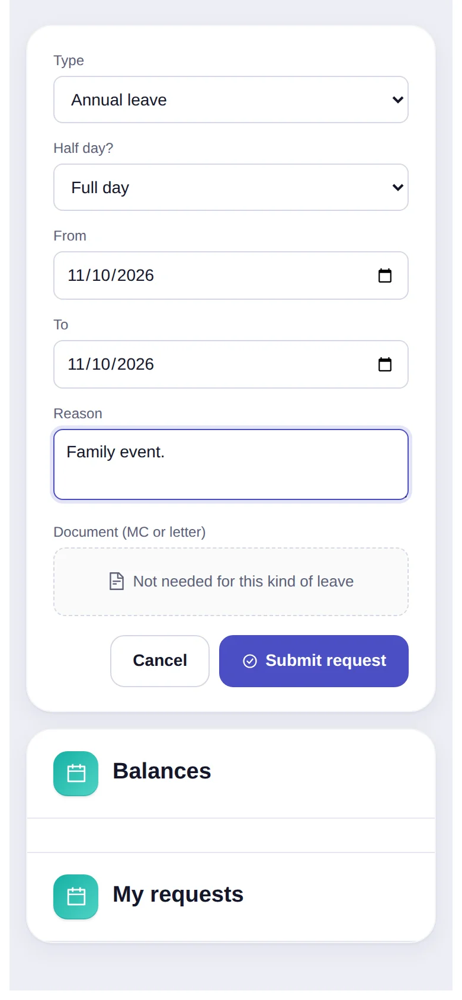

My Kuwick → **Leave**. Jenis: Annual leave, 10 November, dengan sebab. Kuwick menunjukkan bilangan hari dan baki selepas itu.

**Semak:** baki selepas; dia mula pada Oktober, jadi dia ada 1.5 hari tahun ini.

### E2. Cuti tanpa gaji

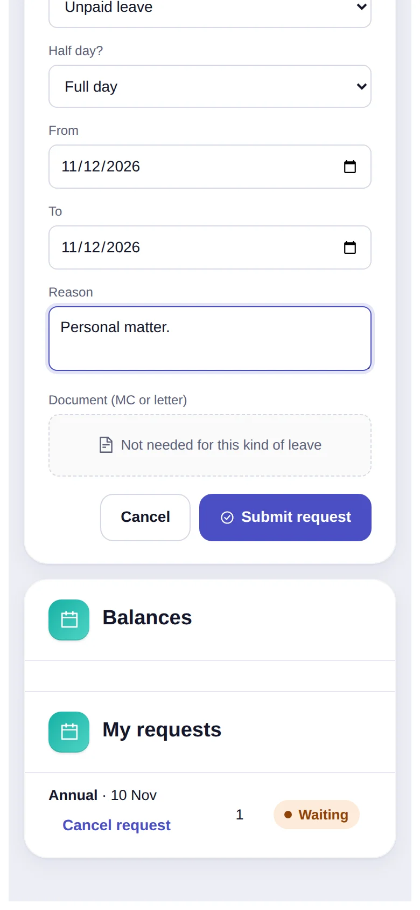

Jenis: Unpaid leave, 12 November. **Submit request**.

**Semak:** cuti tanpa gaji tiada baki; gaji menolaknya.

### E3. Permohonannya

**Semak:** kedua-duanya tersenarai di bawah **My requests**, menunggu keputusan.

### E4. Senarai HR

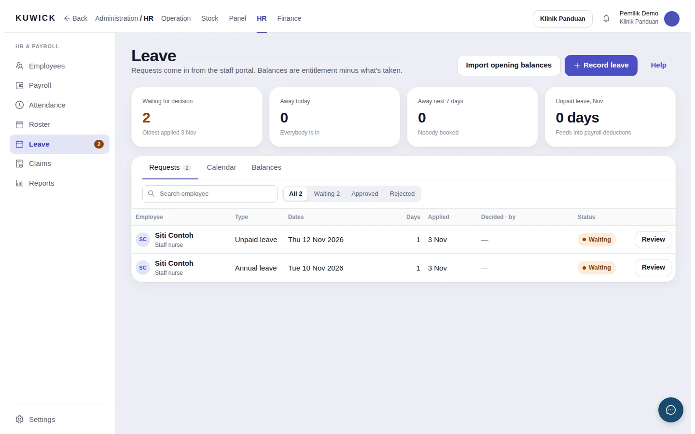

HR → **Leave** menunjukkan permohonan yang menunggu keputusan. Tekan **Review** pada satu baris.

**Semak:** kiraan "Waiting for decision" dan lencana di menu.

### E5. Luluskan cuti tahunan

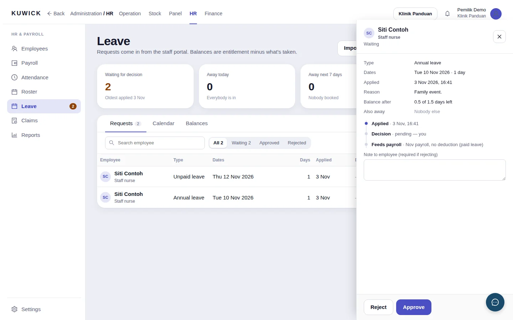

Laci itu menunjukkan tarikh, baki selepas, siapa lagi bercuti, dan kesannya pada gaji. Tekan **Approve**.

**Semak:** "Feeds payroll: no deduction (paid leave)". (Semasa ujian ini tertulis "Annual leave leave"; sudah dibaiki, lihat masalah 2.)

### E6. Luluskan cuti tanpa gaji

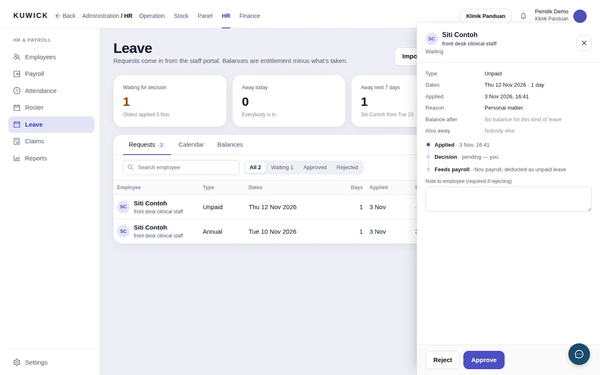

**Semak:** "Feeds payroll" menyatakan gaji November dikurangkan sehari.

### E7. Kedua-duanya diluluskan

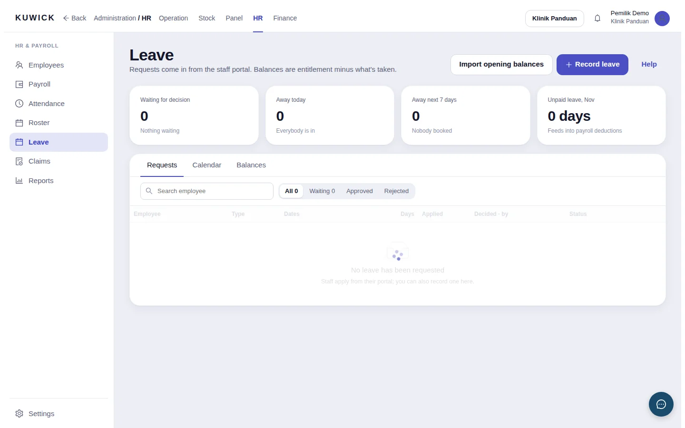

**Semak:** kedua-dua baris "Approved"; ia muncul dalam roster dan kalendar cuti.

## F. Tuntutan

### F1. Tuntutan perbatuan

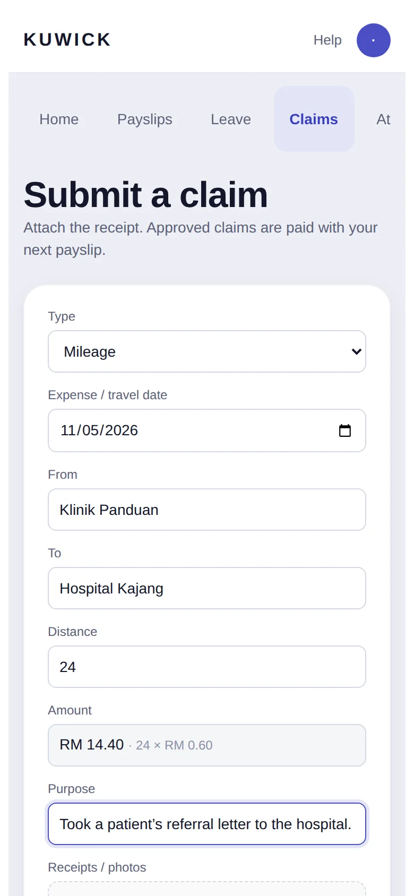

My Kuwick → **Claims**. Jenis: Mileage, tarikh, dari dan ke, serta jarak. Kuwick mengira jumlahnya dari kadar sekilometer klinik (24 km × RM 0.60 = RM 14.40).

**Semak:** kadar sekilometer ialah tetapan (Settings → Claims).

### F2. Tuntutan dengan resit

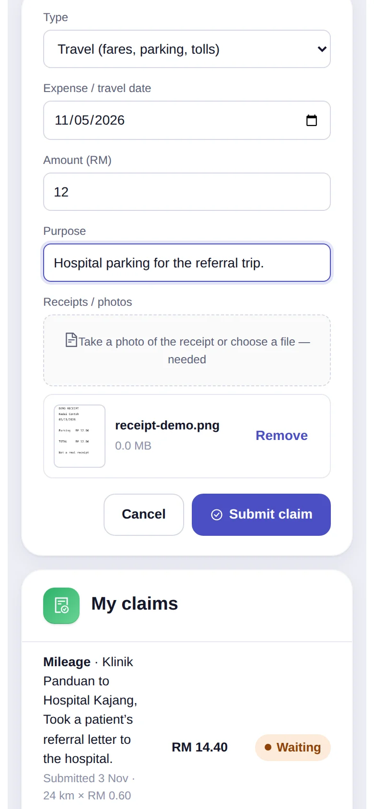

Jenis: Travel (toll, parking, fares), RM 12.00, dengan gambar resit. **Submit claim**.

**Semak:** gambar dilampirkan sebelum menghantar; sesetengah jenis tuntutan mewajibkannya.

### F3. Tuntutannya

**Semak:** kedua-duanya tersenarai di bawah **My claims**, menunggu keputusan.

### F4. Senarai HR

HR → **Claims** menyenaraikan tuntutan yang menunggu. Tekan **Review**.

**Semak:** jumlah yang menunggu di atas.

### F5. Luluskan perbatuan

Laci menunjukkan cara Kuwick mengira harganya (24 km × RM 0.60). Anda boleh meluluskan jumlah yang lebih kecil, dengan nota. Tekan **Approve RM 14.40**.

**Semak:** "Paid from: With their salary", jadi ia masuk gaji.

### F6. Luluskan tuntutan resit

Buka resit untuk menyemaknya, kemudian **Approve RM 12.00**.

**Semak:** jumlah dan tarikh pada resit sama dengan tuntutan.

### F7. Diluluskan, menunggu gaji

**Semak:** kad "Approved, not yet paid" menunjukkan RM 26.40, masuk gaji November.

## G. Gaji

### G1. Payroll dibuka pada bulan ini, dan bertanya tentang Oktober

HR → **Payroll** dibuka pada bulan semasa. Kedua-dua orang mula bekerja pada Oktober, jadi Kuwick memberi amaran bahawa Oktober tiada gaji dan PCB mungkin terkurang.

**Semak:** sentiasa jalankan bulan mengikut turutan. Tekan **Run October payroll**.

### G2. Mulakan Oktober

Tekan **Start October 2026 payroll**. Kuwick mengira setiap slip gaji dari rekod.

**Semak:** bilangan slip gaji yang akan dibuat.

### G3. Oktober siap dikira

Sel kelabu datang dari rekod; sel putih boleh diubah untuk bulan ini. Siti dibayar dari 15 Oktober sahaja (17 daripada 31 hari).

**Semak:** gaji pokok setiap orang; apa-apa bertanda "Needs attention" (di sini: tiada no. cukai).

### G4. Semakan: akui amaran

**Review** menyenaraikan apa yang perlu tindakan. Amaran (bukan sekatan) boleh diakui dengan sebab; sebab itu kekal dalam rekod.

**Semak:** item yang disekat mesti dibaiki di sumbernya (rekod pekerja, kehadiran atau cuti), bukan diakui.

### G5. Luluskan Oktober

Senarai semak dan jumlahnya. Tekan **Approve October 2026 payroll**, kemudian **Approve**.

**Semak:** gaji bersih dan kos kepada klinik. ⚠ Lihat masalah 4 dan 5.

### G6. Bayar Oktober

**Pay** → **Prepare the payment batch** → **Download instruction listing (CSV)**. Bayar di bank anda, kemudian **Record the transfer** dengan tarikh dan rujukan bank.

**Semak:** Kuwick tidak memindahkan wang. Bulan itu "dibayar" hanya apabila anda merekod pemindahan.

### G7. Mulakan November

Kembali ke November, tekan **Start November 2026 payroll**.

**Semak:** amaran Oktober sudah hilang.

### G8. Di mana lebih masa, cuti tanpa gaji dan tuntutan muncul

Baris Siti: **OT h** 2.0 dan **OT RM** 39.99 (diluluskan di Attendance), **Unpaid d** 1 dan **Unpaid RM** 86.67 (diluluskan di Leave), **Claims** 26.40 (diluluskan di Claims).

**Semak:** angka yang nampak salah dibaiki di sumbernya (Attendance, Leave atau Claims); kemudian tekan **Work the month out again**.

### G9. Bulan seorang pekerja

Klik nama untuk slip gaji orang itu seperti sekarang, dengan **What fed this month** dan **How this was worked out**.

**Semak:** tag setiap baris (Attendance, Claims, Leave) menunjukkan dari mana ia datang.

### G10. Semakan: banding dengan bulan lepas

Langkah Review kini membandingkan November dengan Oktober, orang demi orang.

**Semak:** perubahan besar pada gaji bersih. Gaji Siti lebih tinggi kerana Oktober bulan tidak penuh.

### G11. Luluskan November

**Semak:** senarai semak semuanya bertanda, kemudian luluskan. (Sebenarnya anda meluluskan di hujung bulan; ujian ini menjalankan November pada 3 November untuk menunjukkan skrin. Lihat masalah 8.)

### G12. Slip gaji

**Pay** menyenaraikan slip gaji setiap orang: **Print** atau **PDF**. Staf juga nampak slip mereka di My Kuwick.

**Semak:** slip gaji dibuat dari angka yang diluluskan dan tidak berubah; pembetulan membuat semakan (revision) baharu.

### G13. Slip gaji itu

**Semak:** nombor berkanun syarikat, lebih masa, kedua-dua tuntutan, hari tanpa gaji, dan dua tarikh bayaran (tuntutan pada 15hb, gaji pada 30hb).

### G14. Senarai bayaran dan pemindahan

November ada dua tarikh bayaran, jadi ada dua senarai (CSV) dan dua pemindahan untuk direkod.

**Semak:** jumlah senarai sama dengan apa yang anda masukkan di bank. CSV ini senarai untuk dimasukkan atau disemak, bukan fail muat naik bank.

### G15. Kedua-dua pemindahan direkod

**Semak:** setiap tarikh tertulis "Transfer recorded" dengan rujukannya.

### G16. Caruman berkanun: KWSP

**Pay** → **Statutory filing helper**. Satu tab untuk setiap agensi: siapa perlu ditambah atau dibuang di portal, senarai mengikut susunan portal, dan jumlah yang perlu dibayar.

**Semak:** "Add before keying" menyenaraikan pekerja baharu untuk i-Akaun (Majikan).

### G17. PERKESO, SIP dan LINDUNG

**Semak:** lajur PERKESO, SIP dan LINDUNG 24 JAM, pekerja dan majikan, untuk PERKESO ASSIST.

### G18. PCB (LHDN)

**Semak:** PCB setiap orang untuk e-PCB Plus. Di sini RM 0.00 untuk kedua-duanya: mereka mula pada Oktober, dan kaedah cukai hanya mengira gaji tahun ini. No. cukai yang tiada ditunjuk "Not on file".

### G19. Levi HRD Corp

**Semak:** levi (0.5% di sini, "By choice") untuk e-TRiS.

### G20. Tandakan sudah dihantar

Selepas membayar di portal, tekan **Mark as submitted** dengan tarikh dan rujukan portal.

**Semak:** setiap agensi tertulis "Filed" dengan tarikhnya. Kuwick sendiri tidak menghantar apa-apa.

### G21. Slip gaji jururawat di telefonnya

**Semak:** dia nampak slip gaji November sebaik bulan itu diluluskan.

## H. Akhir tahun

### H1. Borang akhir tahun

HR → **Reports** → **Year-end forms**, tahun 2026. **Check before you print** menyenaraikan apa yang tiada (di sini: no. cukai jururawat). Tekan **PDF** pada satu baris, atau **Download all**.

**Semak:** berikan Borang EA kepada setiap pekerja sebelum hujung Februari; hantar Borang E sebelum 31 Mac.

### H2. Borang EA

**Semak:** nombor majikan, tarikh mula (bahagian A9), jumlah gaji di bahagian B, PCB di bahagian D, serta KWSP dan PERKESO di bahagian E.

## Masalah yang ditemui

Semasa ujian, langkah-langkah ini rosak, mengelirukan atau gagal. Setiap satu menyatakan apa yang dilihat dan apa yang dibuat.

1. **Rosak, sudah dibaiki (D6).** HR tidak dapat merekod clock-in untuk hari tanpa sebarang rekod: menyimpan meminta sebab, tetapi borang itu tiada kotak sebab. Dibaiki dalam kumpulan ini: sebab hanya diminta apabila rekod sedia ada diubah.
2. **Perkataan, sudah dibaiki (E5).** Semakan cuti tertulis "Annual leave leave". Dibaiki.
3. **Tidak disokong (B12, C7).** Gaji hanya membayar gaji bulanan. Lokum yang dibayar ikut jam atau sesi tidak boleh dibayar melalui gaji, dan tiada skrin untuk menanda seseorang sebagai kontraktor. Cara yang berfungsi: letakkan lokum luar dalam roster ikut nama dan bayar dengan baucar bayaran melalui Finance.
4. **Mengelirukan (A5, G5).** Wizard berkata "Approved by: Somebody other than the preparer", tetapi pemilik meluluskan seorang diri. Ini dibenarkan oleh tetapan "pemilik boleh meluluskan gajinya sendiri" (hidup secara asal, untuk klinik seorang), tetapi wizard tidak menyebutnya.
5. **Mengelirukan (G5).** Selepas no. cukai yang tiada diakui, senarai semak Approve tertulis "EPF and income tax numbers on file — Everyone's numbers are on file", walaupun jururawat masih tiada no. cukai.
6. **Mengelirukan (D9).** Di Attendance, kad tertulis "On time today" dan "OT today" walaupun hari lain sedang ditunjuk.
7. **Mengelirukan (C4–C10).** Roster menyenaraikan akaun pemilik sendiri sebagai satu baris, walaupun pemilik tiada rekod HR dan tidak dibayar gaji.
8. **Soalan (G11).** Kuwick membenarkan November diluluskan pada 3 November, sebelum kebanyakan bulan itu berlaku. Satu-satunya tanda ialah "1 day has no clock-in or clock-out". Amaran seperti "bulan ini belum tamat" mungkin membantu.
9. **Perkataan (A5).** Ringkasan Pay rules tertulis "overtime on Days in the month", yang sukar difahami.
10. **Nampak salah, sebenarnya betul (G18, H2).** PCB RM 0.00 untuk doktor bergaji RM 9,000 sebulan. Dia mula pada Oktober, dan kaedah berkomputer HASiL hanya mengira gaji tahun kalendar ini (RM 15,030 bercukai selepas pelepasan), jadi belum ada cukai. **How this was worked out** pada bulan orang itu menunjukkan angkanya.
